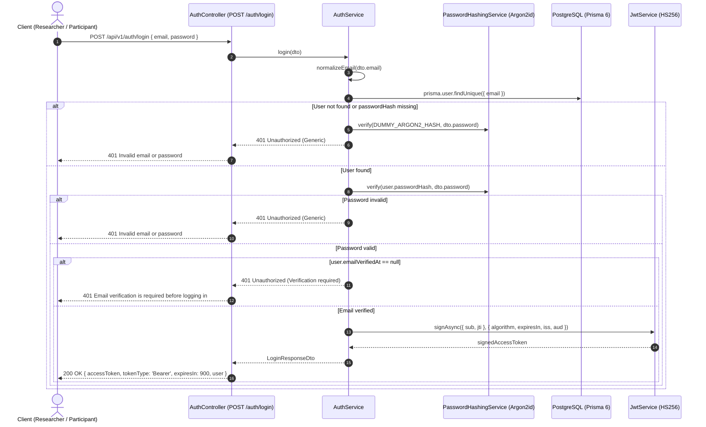

# Access Token Authentication Architecture
## Phase 3.4: Login, JWT Access Tokens & Protected Routes

### 1. Architectural Overview

Phase 3.4 implements secure, stateless authentication for the **Andemta** Ethiopian Consumer Research Marketplace backend. It builds directly upon:
- **Phase 3.1**: Authentication database foundation (PostgreSQL + Prisma 6).
- **Phase 3.2**: Password hashing with Argon2id and user registration.
- **Phase 3.3**: Email verification with Nodemailer and Brevo SMTP.

This phase provides:
1. **Email & Password Login**: Case-insensitive email normalization, timing-attack-resistant credential checking with Argon2id, and email verification gating.
2. **Stateless JWT Access Tokens**: Signed with HMAC-SHA256 (`HS256`), containing minimal claims (`sub`, `jti`, `iss`, `aud`), with a configurable short lifetime (default: 15 minutes).
3. **Passport JWT Strategy & Guard**: Automatic bearer token extraction from the `Authorization: Bearer <token>` header, signature and claims verification, and database user resolution.
4. **`@CurrentUser()` Parameter Decorator**: Type-safe extraction of the authenticated user in NestJS controllers.
5. **Protected Route Verification**: Minimal protected endpoint (`GET /api/v1/auth/me`) demonstrating the guard, response envelope, and OpenAPI security definitions.



---

### 2. Login Flow & Security Controls

#### A. Email Normalization
- Consistent with Phase 3.2 and 3.3, all candidate emails are trimmed of leading/trailing whitespace and converted to lowercase before database querying.
- The user's plaintext password is **never trimmed, normalized, or transformed**, preserving Unicode passwords (e.g. Amharic characters `ሰላም ዓለም`) and intentional spacing.

#### B. Timing Attack Mitigation (Dummy Hash Verification)
- To prevent side-channel timing attacks from revealing whether an email address exists in the database:
  - If the user account does not exist or has a `null` password hash (e.g. external OAuth accounts), the system verifies candidate credentials against a pre-computed standard Argon2id hash (`DUMMY_ARGON2_HASH`).
  - The request always consumes ~30–50ms of CPU compute regardless of account existence.
  - Returns a generic `401 Unauthorized` (`Invalid email or password`).

#### C. Mandatory Email Verification Gate
- If a user's credentials match but `emailVerifiedAt` is `null`:
  - Access token generation is strictly blocked.
  - The API responds with `401 Unauthorized`:
    ```json
    {
      "success": false,
      "message": "Email verification is required before logging in. Please check your inbox.",
      "data": null,
      "errors": []
    }
    ```
  - Unverified accounts cannot authenticate or access protected endpoints until verified via `/api/v1/auth/verify-email`.

---

### 3. JWT Access Token Specification

#### A. Configuration & Environment Variables
Configured via `ConfigModule` and validated at startup using Joi:

| Variable | Type | Default | Description |
|---|---|---|---|
| `JWT_ACCESS_SECRET` | string (min 32 chars) | *Required* | Strong, unpredictable secret key for HS256 signing |
| `JWT_ACCESS_EXPIRES_IN` | string | `15m` | Token validity duration (e.g. `15m`, `1h`, `900s`) |
| `JWT_ISSUER` | string | `andemta-api` | Expected issuer claim (`iss`) |
| `JWT_AUDIENCE` | string | `andemta-client` | Expected audience claim (`aud`) |

#### B. Cryptographic Signing Algorithm
- **Algorithm**: `HS256` (HMAC with SHA-256).
- Signing options explicitly specify `algorithm: 'HS256'`.
- The `JwtStrategy` explicitly restricts accepted algorithms to `['HS256']`, preventing algorithm-confusion attacks (e.g., `none` algorithm exploit).

#### C. Token Payload & Claims
Access tokens are stateless and minimal:
```json
{
  "sub": "c1f7a049-74d1-4db8-b570-5b5832a52df4",
  "jti": "5a44369a-6536-4c4f-b6e8-232f05151b72",
  "iss": "andemta-api",
  "aud": "andemta-client",
  "iat": 1731571200,
  "exp": 1731572100
}
```

- `sub`: The authenticated user's unique PostgreSQL UUID.
- `jti`: Cryptographically generated UUID v4 (`crypto.randomUUID()`) to uniquely distinguish every issued access token.
- `iss`: Configured API issuer (`andemta-api`).
- `aud`: Configured client audience (`andemta-client`).
- `iat` / `exp`: Issued-at and expiration Unix timestamps.

> [!NOTE]
> The payload contains **no sensitive information**, no password hashes, no verification secrets, and no role claims (roles are deferred to future RBAC phases).

---

### 4. Passport Strategy & Guard

#### A. Strategy (`JwtStrategy`)
Extends `PassportStrategy(Strategy, 'jwt')`:
1. Extracts Bearer token from `Authorization: Bearer <token>` header.
2. Verifies cryptographic signature using `JWT_ACCESS_SECRET`.
3. Validates expiration (`ignoreExpiration: false`).
4. Enforces expected `iss`, `aud`, and `HS256` algorithm.
5. In `validate(payload)`:
   - Validates payload structure and ensures `sub` is present.
   - Queries PostgreSQL for the user record.
   - If user no longer exists, rejects with `401 Unauthorized` (`User account no longer exists`).
   - If user is not email-verified, rejects with `401 Unauthorized` (`Email verification is required to access this resource`).
   - Returns safe `AuthenticatedUser` projection:
     ```typescript
     export interface AuthenticatedUser {
       id: string;
       email: string;
       emailVerifiedAt: Date;
     }
     ```

#### B. Guard (`JwtAuthGuard`)
Extends `AuthGuard('jwt')`:
- Intercepts requests on protected endpoints.
- Maps internal Passport/JWT errors into clear, human-readable client error messages:
  - Expired tokens -> `"Access token has expired"` (401).
  - Malformed or invalid signature -> `"Invalid access token"` (401).
  - Missing Authorization header -> `"Missing Bearer authentication token"` (401).

#### C. Decorator (`@CurrentUser()`)
Type-safe custom parameter decorator extracting the authenticated user object (or an individual property) from the request:
```typescript
@Get('me')
@UseGuards(JwtAuthGuard)
getProfile(@CurrentUser() user: AuthenticatedUser) {
  return user;
}

// Or specific field:
@Get('me/id')
@UseGuards(JwtAuthGuard)
getUserId(@CurrentUser('id') userId: string) {
  return { userId };
}
```

---

### 5. API Endpoints Specification

#### A. Login Endpoint
- **Route**: `POST /api/v1/auth/login`
- **Request Body**:
  ```json
  {
    "email": "researcher@andemta.et",
    "password": "SecurePassword123!"
  }
  ```
- **Success Response (`200 OK`)**:
  ```json
  {
    "success": true,
    "message": "Login successful",
    "data": {
      "accessToken": "eyJhbGciOiJIUzI1NiIsInR5cCI6IkpXVCJ9...",
      "tokenType": "Bearer",
      "expiresIn": 900,
      "user": {
        "id": "c1f7a049-74d1-4db8-b570-5b5832a52df4",
        "email": "researcher@andemta.et",
        "emailVerifiedAt": "2026-11-14T10:00:00.000Z"
      }
    },
    "meta": null
  }
  ```
- **Error Responses**:
  - `400 Bad Request`: Validation failure (invalid email format, missing password).
  - `401 Unauthorized`: `"Invalid email or password"` (generic credentials error).
  - `401 Unauthorized`: `"Email verification is required before logging in. Please check your inbox."` (unverified email).

#### B. Protected Profile Demonstration Endpoint
- **Route**: `GET /api/v1/auth/me`
- **Headers**: `Authorization: Bearer <accessToken>`
- **Success Response (`200 OK`)**:
  ```json
  {
    "success": true,
    "message": "Profile retrieved successfully",
    "data": {
      "id": "c1f7a049-74d1-4db8-b570-5b5832a52df4",
      "email": "researcher@andemta.et",
      "emailVerifiedAt": "2026-11-14T10:00:00.000Z"
    },
    "meta": null
  }
  ```
- **Error Responses**:
  - `401 Unauthorized`: `"Missing Bearer authentication token"` (header omitted).
  - `401 Unauthorized`: `"Invalid access token"` (bad signature / tampered).
  - `401 Unauthorized`: `"Access token has expired"` (expired token).

---

### 6. Security Considerations & Protections

1. **Strict Response Envelope & Projection**:
   The Prisma `User` record is never returned raw. Sensitive fields (`passwordHash`, `emailVerificationTokens`, `sessions`) are completely excluded.
2. **Log Redaction**:
   Pino logger configuration in `AppModule` redacts `req.headers.authorization`, `req.headers.cookie`, and `req.body.password`.
3. **Helmet HTTP Headers**:
   Strict security headers active across all responses.
4. **CORS Restrictions**:
   CORS is locked to configured frontend URLs with credentials enabled.
5. **No Refresh Tokens or Sessions in Phase 3.4**:
   Phase 3.4 issues **stateless access tokens only**. No database `Session` records are created and no refresh tokens are generated or rotated.

---

### 7. How to Run Automated Tests

#### Run Unit Tests
```powershell
npm run test:api
```
*(Runs 22 unit test suites covering login service, DTOs, strategies, guards, and decorators).*

#### Run Integration Tests
```powershell
npm run test:api:e2e
```
*(Runs 4 E2E test suites against PostgreSQL: registration, email verification, login, protected endpoint authorization, and guard rejections).*

---

### 8. Explicit Current Limitations & Next Steps

The following capabilities are deliberately excluded from Phase 3.4 and planned for upcoming phases:
- **Refresh Token Rotation & Session Management**: Deferred to Phase 3.5.
- **Logout & Revocation**: Deferred to Phase 3.5.
- **Password Reset Flow**: Deferred to Phase 3.6.
- **Role-Based Access Control (RBAC)**: Deferred to Phase 3.7.
- **Frontend Login & Token Storage**: Deferred to Phase 4.
