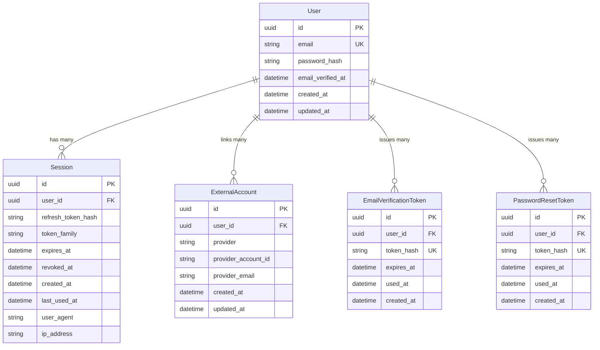

# Authentication Database Architecture (Phase 3.1)

This document details the database foundation for the authentication subsystem of the **Andemta** Consumer Research Marketplace.

---

## 1. Overview & Conceptual Architecture

The authentication database layer is designed to support credential-based authentication (email + password), federated identity (Google OAuth), and secure token/session lifecycles without coupling to business logic or profile metadata.

### Conceptual Entity Relationships



---

## 2. Models & Schema Definitions

All tables use native PostgreSQL `UUID` primary keys (`@db.Uuid`) and standard lowercase plural database table mappings (`@@map`).

### A. `User` (`users`)
Represents an identity account in Andemta.

| Field | Type | Nullable | Description |
|---|---|---|---|
| `id` | `UUID` | No | Primary key, automatically generated via `uuid()`. |
| `email` | `String` | No | Globally unique account email. |
| `passwordHash` | `String` | **Yes** | Argon2id hash. Nullable for Google-only OAuth accounts. |
| `emailVerifiedAt` | `DateTime` | **Yes** | Timestamp when email verification was completed. Null if unverified. |
| `createdAt` | `DateTime` | No | Timestamp of creation (`@default(now())`). |
| `updatedAt` | `DateTime` | No | Automatically updated timestamp (`@updatedAt`). |

### B. `Session` (`sessions`)
Tracks authenticated user sessions and refresh token rotation state.

| Field | Type | Nullable | Description |
|---|---|---|---|
| `id` | `UUID` | No | Primary key (`uuid()`). |
| `userId` | `UUID` | No | Foreign key referencing `users.id`. |
| `refreshTokenHash` | `String` | No | Cryptographic hash (SHA-256) of the active refresh token. |
| `tokenFamily` | `String` | No | Unique identifier for a refresh token family (rotation & reuse detection). |
| `expiresAt` | `DateTime` | No | Hard expiration timestamp of the session/refresh token. |
| `revokedAt` | `DateTime` | **Yes** | Timestamp when session was revoked (logout, password change, breach). |
| `createdAt` | `DateTime` | No | Initial login timestamp (`@default(now())`). |
| `lastUsedAt` | `DateTime` | **Yes** | Updated whenever refresh token is exchanged for a new access token. |
| `userAgent` | `String` | **Yes** | Client `User-Agent` string for session auditing and device lists. |
| `ipAddress` | `String` | **Yes** | Client IP address at session creation/usage. |

### C. `ExternalAccount` (`external_accounts`)
Links third-party OAuth provider identities to a unified `User`.

| Field | Type | Nullable | Description |
|---|---|---|---|
| `id` | `UUID` | No | Primary key (`uuid()`). |
| `userId` | `UUID` | No | Foreign key referencing `users.id`. |
| `provider` | `String` | No | Provider identifier (e.g., `'google'`). |
| `providerAccountId` | `String` | No | Stable external identifier from provider (Google `sub` claim). |
| `providerEmail` | `String` | **Yes** | Email reported by provider at time of linkage. |
| `createdAt` | `DateTime` | No | Creation timestamp. |
| `updatedAt` | `DateTime` | No | Update timestamp. |

### D. `EmailVerificationToken` (`email_verification_tokens`)
Manages single-use email verification tokens.

| Field | Type | Nullable | Description |
|---|---|---|---|
| `id` | `UUID` | No | Primary key (`uuid()`). |
| `userId` | `UUID` | No | Foreign key referencing `users.id`. |
| `tokenHash` | `String` | No | Cryptographic hash (SHA-256) of the plain verification token. |
| `expiresAt` | `DateTime` | No | Expiration timestamp (e.g. 24 hours from creation). |
| `usedAt` | `DateTime` | **Yes** | Timestamp when token was consumed. Null if unconsumed. |
| `createdAt` | `DateTime` | No | Creation timestamp. |

### E. `PasswordResetToken` (`password_reset_tokens`)
Manages single-use password recovery tokens.

| Field | Type | Nullable | Description |
|---|---|---|---|
| `id` | `UUID` | No | Primary key (`uuid()`). |
| `userId` | `UUID` | No | Foreign key referencing `users.id`. |
| `tokenHash` | `String` | No | Cryptographic hash (SHA-256) of the password reset token. |
| `expiresAt` | `DateTime` | No | Expiration timestamp (e.g. 1 hour from creation). |
| `usedAt` | `DateTime` | **Yes** | Timestamp when password reset was consumed. |
| `createdAt` | `DateTime` | No | Creation timestamp. |

---

## 3. Constraints & Indexing Decisions

### Unique Constraints
1. **`users.email` (`users_email_key`):** Guarantees that only one account exists per normalized email address.
2. **`external_accounts(provider, provider_account_id)` (`external_accounts_provider_provider_account_id_key`):** Composite unique constraint ensuring that an external Google `sub` identity cannot be linked to multiple accounts simultaneously.
3. **`email_verification_tokens.token_hash` (`email_verification_tokens_token_hash_key`):** Enforces unique hashes and provides $O(1)$ lookups during verification.
4. **`password_reset_tokens.token_hash` (`password_reset_tokens_token_hash_key`):** Enforces unique hashes and provides $O(1)$ lookups during password recovery.

### Performance Indexes
- **`sessions(user_id)`:** Accelerates fetching all active sessions for a user (e.g. "Manage devices" or "Log out all sessions").
- **`sessions(token_family)`:** Essential for refresh token rotation; immediately locates all ancestor/child tokens in a family if reuse is detected.
- **`sessions(expires_at)`:** Optimizes automated cleanup jobs purging expired sessions.
- **`sessions(revoked_at)`:** Accelerates active-session filtering queries.
- **`external_accounts(user_id)`:** Optimizes retrieving linked accounts on user profile requests.
- **`email_verification_tokens(user_id)` / `password_reset_tokens(user_id)`:** Supports revoking previous unconsumed tokens when a new one is requested.
- **`email_verification_tokens(expires_at)` / `password_reset_tokens(expires_at)`:** Optimizes background token retention cleanup jobs.

---

## 4. Security & Storage Strategies

### Token Hashing Strategy
- **Plaintext tokens are NEVER stored in the database.**
- When a user requests an email verification or password reset, a cryptographically secure random string (e.g. `crypto.randomBytes(32).toString('hex')`) is generated.
- The raw token is sent to the user via email / magic link.
- Only the **SHA-256 hash** of the token is persisted into `token_hash`.
- When the user submits the token, the backend hashes the incoming string and queries by `token_hash`. This ensures that even if database read access is compromised, tokens cannot be extracted or hijacked.

### Password Hashing Strategy
- Passwords will be hashed using **Argon2id** (Phase 3.2).
- The `password_hash` column is nullable to allow seamless support for users who register exclusively using Google OAuth without creating a password.

### Email Normalization Strategy
- PostgreSQL text comparison is case-sensitive by default.
- In the application layer (DTO validation and authentication services), all emails **MUST** be:
  1. Trimmed of leading/trailing whitespace: `.trim()`
  2. Converted to lowercase: `.toLowerCase()`
- This prevents duplicate accounts like `User@Example.com` and `user@example.com` while maintaining database portability.

---

## 5. Referential Integrity & Deletion Behavior

All authentication child tables declare:
```prisma
user User @relation(fields: [userId], references: [id], onDelete: Cascade)
```
- If a user account is deleted (GDPR / right to be forgotten), all corresponding `sessions`, `external_accounts`, `email_verification_tokens`, and `password_reset_tokens` are **automatically cascade-deleted** by the PostgreSQL engine.
- No orphaned authentication tokens or ghost sessions can remain in the database.

---

## 6. Expired Token & Session Cleanup Strategy

Because tokens and sessions are short-lived, automated cleanup is scheduled using **BullMQ** (via the existing Redis infrastructure):
- **Cron Job:** Runs once daily (e.g. `0 3 * * *` at 03:00 UTC).
- **Cleanup Query:**
  - `DELETE FROM "sessions" WHERE "expires_at" < NOW() - INTERVAL '30 days';`
  - `DELETE FROM "email_verification_tokens" WHERE "expires_at" < NOW() - INTERVAL '7 days' OR "used_at" IS NOT NULL;`
  - `DELETE FROM "password_reset_tokens" WHERE "expires_at" < NOW() - INTERVAL '7 days' OR "used_at" IS NOT NULL;`
- Retaining expired tokens for a short audit grace period (7 days) allows logging attempts to reuse dead tokens for intrusion detection before purging.

---

## 7. Migration Execution Guide

Migrations are managed with Prisma Migrate:

1. **Apply Migrations in Development:**
   ```powershell
   npm run prisma:migrate:dev
   ```

2. **Validate Schema:**
   ```powershell
   npm run prisma:validate
   ```

3. **Format Schema:**
   ```powershell
   npm run prisma:format
   ```

4. **Regenerate Prisma Client:**
   ```powershell
   npm run prisma:generate
   ```

5. **Apply Pending Migrations in Production:**
   ```powershell
   npm run prisma:migrate:deploy
   ```

