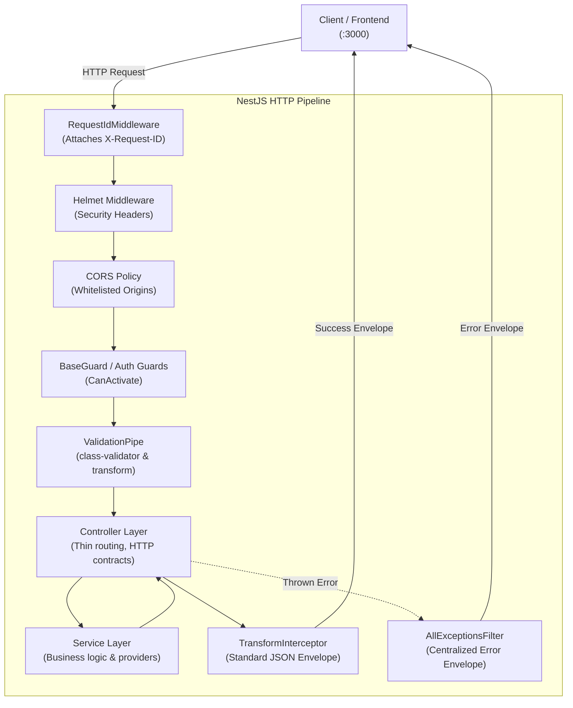

# Andemta Backend Architecture Foundation (Phase 1)

This document provides a comprehensive architectural guide to the **Andemta API** backend (`@andemta/api`), its request lifecycle, security controls, standards, and conventions.

---

## 1. NestJS Application Architecture

The Andemta backend is designed as a **Modular Monolith** using [NestJS](https://nestjs.com/) and TypeScript in strict mode.



---

## 2. Module & Provider Responsibilities

- **Modules (`*.module.ts`):** Define the organizational boundaries of the application. They encapsulate related controllers and services, configure imports, and selectively export public providers.
- **Controllers (`*.controller.ts`):** Thin HTTP adapters responsible only for routing, request extraction, invoking service methods, and mapping HTTP semantics. No business logic belongs in controllers.
- **Services (`*.service.ts`):** Encapsulate domain rules, state operations, integrations, and business workflows.
- **Custom Providers:** Injected via standard constructor injection. Custom providers or factory providers are used where runtime configuration is required.

---

## 3. Dependency Injection (DI)

NestJS relies on an inversion-of-control (IoC) container:
- All services and providers are decorated with `@Injectable()`.
- Dependencies are declared explicitly in class constructors using `private readonly` parameters:
  ```typescript
  @Controller('health')
  export class HealthController {
    constructor(private readonly healthService: HealthService) {}
  }
  ```
- **Rules:**
  - Avoid service locators or manual `new Service()` instantiation.
  - Avoid circular module dependencies.
  - Do not create global modules unless universally required (such as `ConfigModule`).

---

## 4. Request Lifecycle

The incoming HTTP request follows this strict sequence:

1. **Express Middleware:**
   - `RequestIdMiddleware`: Generates or validates `X-Request-ID`.
   - `helmet`: Sets standard security HTTP headers.
   - `pino-http`: Binds request logging context and starts high-resolution timer.
2. **Global Prefix & Routing:**
   - Path routed under `/api/v1/*`.
3. **Guards:**
   - Evaluate `CanActivate` criteria (authentication, role checks).
4. **Interceptors (Pre-Controller):**
   - Execute before route handlers (timing, caching checks).
5. **Pipes:**
   - `ValidationPipe`: Whitelists, transforms, and validates payload DTOs.
6. **Controller Handler:**
   - Thin handler invokes domain services.
7. **Interceptors (Post-Controller):**
   - `TransformInterceptor`: Enforces standard `{ success, message, data, meta }` envelope.
8. **Exception Filters:**
   - `AllExceptionsFilter`: Catches any thrown exception, maps HTTP code, and returns standard `{ success: false, message, errors }` envelope.

---

## 5. Middleware, Guards, Interceptors, and Pipes

### 5.1 Request ID Middleware (`RequestIdMiddleware`)
- Located: `src/common/middleware/request-id.middleware.ts`
- **Policy:** Generates a cryptographically secure UUID v4 using Node's `crypto.randomUUID()`.
- **Validation:** Incoming `x-request-id` headers are validated against `/^[a-zA-Z0-9\-_]{8,64}$/`. If invalid or missing, a fresh UUID v4 is created.
- Injects `req.id` and sets the outgoing `X-Request-ID` response header.

### 5.2 Guards (`BaseGuard`)
- Located: `src/common/guards/base.guard.ts`
- Acts as the baseline guard for request authentication and role verification.

### 5.3 Response Interceptor (`TransformInterceptor`)
- Located: `src/common/interceptors/transform.interceptor.ts`
- Automates the standard response envelope.
- Supports `@ResponseMessage('Custom message')` to assign custom success messages.
- Supports `@BypassTransform()` for raw file downloads or streaming responses.
- Guards against double-wrapping already wrapped structures.

### 5.4 Validation Pipe
- Located: `src/common/pipes/validation.pipe.ts`
- Enforces `whitelist: true`, `transform: true`, and `forbidNonWhitelisted: true`.
- Translates `ValidationError` trees into structured `{ field, message }` error lists.

---

## 6. Centralized Exception Handling

- Located: `src/common/filters/all-exceptions.filter.ts`
- Catches all exceptions application-wide.
- Always returns HTTP response code matching error semantics (400, 401, 403, 404, 409, 422, 500).
- **Production Guard:** When `NODE_ENV === 'production'`, 500 errors never leak internal stack traces, SQL errors, or sensitive exception messages. The client receives `"Internal server error"`.
- Detailed error logs with correlated Request IDs are output via Pino.

---

## 7. Standard API Response Formats

### 7.1 Successful Response
```json
{
  "success": true,
  "message": "Request completed successfully",
  "data": {
    "id": "ex-001",
    "name": "Sample"
  },
  "meta": null
}
```

### 7.2 Paginated Response
```json
{
  "success": true,
  "message": "Records retrieved successfully",
  "data": [
    { "id": "ex-001" }
  ],
  "meta": {
    "page": 1,
    "limit": 10,
    "total": 100,
    "totalPages": 10
  }
}
```

### 7.3 Error Response
```json
{
  "success": false,
  "message": "Validation failed",
  "data": null,
  "errors": [
    {
      "field": "email",
      "message": "Email must be a valid email address"
    }
  ]
}
```

---

## 8. Validation Conventions

All incoming request bodies must be defined with class-based DTOs using `class-validator` and `class-transformer`:

```typescript
export class CreateExampleDto {
  @ApiProperty({ example: 'Abebe Bikila' })
  @IsString()
  @IsNotEmpty()
  @MinLength(2)
  name!: string;

  @ApiProperty({ example: 'abebe@andemta.et' })
  @IsEmail()
  @IsNotEmpty()
  email!: string;
}
```

---

## 9. Configuration & Environment Variables

- Managed by `@nestjs/config` and validated on startup via Joi (`validation.schema.ts`).
- Fails fast during application bootstrap if required environment variables are invalid.

| Variable | Type | Default | Description |
|---|---|---|---|
| `NODE_ENV` | string | `development` | Environment mode (`development`, `production`, `test`) |
| `PORT` | number | `4000` | Port for the NestJS API |
| `FRONTEND_URL` | string (URI) | `http://localhost:3000` | Allowed CORS origin |
| `DATABASE_URL` | string | Optional in Phase 1 | PostgreSQL connection string (Phase 2) |
| `REDIS_HOST` | string | `localhost` | Redis host (Phase 2) |
| `REDIS_PORT` | number | `6379` | Redis port (Phase 2) |
| `REDIS_PASSWORD` | string | Optional | Redis password |
| `SWAGGER_ENABLED` | boolean | `true` | Toggles OpenAPI documentation |

---

## 10. Structured Logging & Request IDs

- Powered by `nestjs-pino` and `pino-http`.
- **Development:** Beautiful, colorized single-line output via `pino-pretty`.
- **Production:** High-throughput newline-delimited JSON with correlated Request IDs.
- **Redaction:** Sensitive fields (`authorization`, `cookie`, `set-cookie`, `password`, `refreshToken`) are automatically masked.

---

## 11. Swagger / OpenAPI Documentation

- Interactive Swagger UI available at:
  `http://localhost:4000/api/docs`
- Documented using `@nestjs/swagger` decorators (`@ApiTags`, `@ApiOperation`, `@ApiResponse`).
- Configurable via `SWAGGER_ENABLED`.

---

## 12. Security & CORS Configuration

- **Helmet:** Enables standard HTTP security headers.
  In development, Content-Security-Policy (CSP) is customized to allow Swagger UI inline styles and scripts.
- **CORS:** Restricts origins to configured frontend URLs, enables credentials, and limits methods to `GET,HEAD,PUT,PATCH,POST,DELETE,OPTIONS`.

---

## 13. Testing Conventions

- **Unit Tests (`*.spec.ts`):** Co-located with source files under `src/`. Run sequentially with `npm run test:api`.
- **E2E Tests (`*.e2e-spec.ts`):** Located in `apps/api/test/`. Bootstraps the full NestJS pipeline and tests against HTTP endpoints using Supertest via `npm run test:api:e2e`.

---

## 14. How to Create a New Module (Developer Guide)

When creating a new domain module in future phases:

1. Create a directory under `src/<module-name>/`.
2. Define DTOs in `src/<module-name>/dto/` with `class-validator` rules and `@ApiProperty()` tags.
3. Define the domain service in `src/<module-name>/<module-name>.service.ts` with business logic.
4. Define the controller in `src/<module-name>/<module-name>.controller.ts`:
   - Annotate with `@ApiTags('<ModuleName>')` and `@Controller('<route>')`.
   - Use `@ResponseMessage('...')` for clear success messaging.
   - Keep methods thin by delegating directly to the service.
5. Create `src/<module-name>/<module-name>.module.ts` and register it in `app.module.ts`.
6. Add unit tests in `<module-name>.controller.spec.ts` and `<module-name>.service.spec.ts`.

