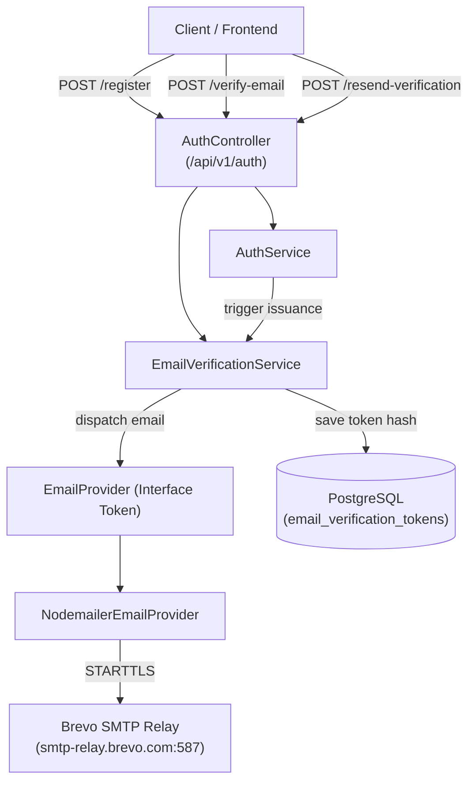

# Email Verification Architecture & Brevo SMTP Integration (Phase 3.3)

This document details the architectural design, security controls, and operational workflows for the **Andemta** backend email verification subsystem using **Nodemailer** and **Brevo SMTP**.

---

## 1. Subsystem Architecture Overview

The email verification subsystem decouples token lifecycle management, database persistence, and transactional email transport into clean architectural boundaries.



### Scope Boundaries
- **Backend Only**: Full REST API implementation with Swagger documentation. No frontend verification pages or resend forms are included in this phase.
- **Isolated Verification**: Verification activates user accounts (`emailVerifiedAt = now()`). It **does NOT** issue JWT tokens, create sessions, or log the user in automatically.

---

## 2. Cryptographic Token Design & Lifecycle

### A. High-Entropy Raw Token Generation
- **Entropy**: Minimum 32 bytes (256 bits) generated via Node.js native `crypto.randomBytes(32)`.
- **Encoding**: URL-safe base64url encoding (`toString('base64url')`), yielding a 43-character alphanumeric string.
- **Security Guarantees**: Never uses `Math.random()`, timestamps, or predictable seeds. Immune to brute-force enumeration.

### B. One-Way SHA-256 Hashing
- Tokens are hashed immediately upon generation using **SHA-256**:
  $$\text{tokenHash} = \text{SHA-256}(\text{rawToken})$$
- **Database Storage**: Only `tokenHash` is persisted in PostgreSQL (`email_verification_tokens.token_hash`).
- **Zero-Exposure Policy**:
  - The raw token is **never** written to database storage.
  - The raw token is **never** logged to console, file, or APM tools.
  - The complete verification URL is **never** logged.
  - Token hashes are **never** returned in HTTP API responses.

### C. Expiration & Single-Use Lifecycle
- **TTL**: Configurable via `EMAIL_VERIFICATION_TOKEN_TTL_MINUTES` (defaults to **30 minutes**).
- **Single-Use**: Once consumed, the token's `used_at` timestamp is set to current time. Subsequent attempts with the same token are rejected with HTTP 400.
- **Replacement Invalidation**: When a new token is issued (via registration retry or resend), all prior unused tokens for that user are marked as used (`used_at = now()`).
- **Concurrent Double-Consumption Guard**: Token consumption uses a database transaction with a conditional update (`UPDATE email_verification_tokens SET used_at = now() WHERE id = :id AND used_at IS NULL`). If two requests arrive simultaneously, exactly one succeeds and the other receives HTTP 400.

---

## 3. Database Schema

Reuses the `EmailVerificationToken` model established in Phase 3.1:

```prisma
model EmailVerificationToken {
  id        String    @id @default(uuid()) @db.Uuid
  userId    String    @map("user_id") @db.Uuid
  tokenHash String    @unique @map("token_hash")
  expiresAt DateTime  @map("expires_at")
  usedAt    DateTime? @map("used_at")
  createdAt DateTime  @default(now()) @map("created_at")

  user User @relation(fields: [userId], references: [id], onDelete: Cascade)

  @@index([userId])
  @@index([expiresAt])
  @@map("email_verification_tokens")
}
```

---

## 4. Nodemailer & Brevo SMTP Integration

### A. SMTP Configuration Parameters
Email delivery is powered by Brevo (formerly Sendinblue) using standard STARTTLS:

| Variable | Brevo Setting | Description |
|---|---|---|
| `EMAIL_PROVIDER` | `nodemailer` | Active email transport engine |
| `EMAIL_HOST` | `smtp-relay.brevo.com` | Brevo SMTP server |
| `EMAIL_PORT` | `587` | Standard STARTTLS port |
| `EMAIL_SECURE` | `false` | Must be `false` for port 587 (negotiates STARTTLS) |
| `EMAIL_USER` | *Your Brevo SMTP Login* | SMTP login from Brevo account (NOT Brevo account email) |
| `EMAIL_PASSWORD` | *Your Generated SMTP Key* | Generated Standard SMTP Master Key (NOT account password) |
| `EMAIL_FROM` | `"Andemta <verified-sender@gmail.com>"` | Must be a verified sender in Brevo |
| `EMAIL_VERIFICATION_TOKEN_TTL_MINUTES` | `30` | Expiration window in minutes |
| `FRONTEND_EMAIL_VERIFICATION_URL` | `http://localhost:3000/verify-email` | Frontend landing page URL |

### B. Connection Settings & Timeouts
`NodemailerEmailProvider` configures hardened network timeouts to prevent hanging sockets:
- `connectionTimeout`: 10,000 ms (10 seconds)
- `greetingTimeout`: 10,000 ms (10 seconds)
- `socketTimeout`: 15,000 ms (15 seconds)
- `tls.rejectUnauthorized`: `true`

### C. Graceful Failure Isolation
- If Brevo SMTP is temporarily unreachable during registration:
  - The created user record is **preserved** (not deleted).
  - The newly created token is **invalidated** immediately so no undelivered active token persists.
  - The user can request another verification email at any time via `/resend-verification`.
  - Application startup does not fail if Brevo is offline.

---

## 5. API Endpoints Specification

### A. Automatic Issuance on Registration
- **Route**: `POST /api/v1/auth/register`
- **Behavior**: Upon successful user creation, `AuthService` triggers `EmailVerificationService.issueVerificationToken()`.
- **Response**: Preserves safe user projection:
  ```json
  {
    "success": true,
    "message": "User registered successfully",
    "data": {
      "id": "c1f7a049-74d1-4db8-b570-5b5832a52df4",
      "email": "researcher@andemta.et",
      "emailVerifiedAt": null,
      "createdAt": "2026-11-13T21:00:00.000Z"
    },
    "meta": null
  }
  ```

### B. Verify Email Endpoint
- **Route**: `POST /api/v1/auth/verify-email`
- **Request Body**:
  ```json
  {
    "token": "dGhpcy1pcy1hLXZhbGlkLWJhc2U2NHVybC10b2tlbg"
  }
  ```
- **Success Response (`200 OK`)**:
  ```json
  {
    "success": true,
    "message": "Email verified successfully",
    "data": {
      "email": "researcher@andemta.et",
      "emailVerifiedAt": "2026-11-13T21:05:00.000Z"
    },
    "meta": null
  }
  ```
- **Error Response (`400 Bad Request`)**:
  Triggered if the token does not exist, has expired, has already been used, or the user is already verified:
  ```json
  {
    "success": false,
    "message": "Invalid or expired verification token",
    "data": null,
    "errors": []
  }
  ```

### C. Resend Verification Endpoint
- **Route**: `POST /api/v1/auth/resend-verification`
- **Request Body**:
  ```json
  {
    "email": "researcher@andemta.et"
  }
  ```
- **Generic Response (`200 OK`)**:
  ```json
  {
    "success": true,
    "message": "If an account requires email verification, a verification email will be sent.",
    "data": {
      "message": "If an account requires email verification, a verification email will be sent."
    },
    "meta": null
  }
  ```
- **Anti-Enumeration Guarantee**: The response is identical whether the account exists, does not exist, or is already verified.

---

## 6. Manual Brevo SMTP Verification Procedure

A dedicated verification utility is provided at [`infrastructure/scripts/test-smtp.ts`](../../infrastructure/scripts/test-smtp.ts).

### Step 1: Configure Credentials in `apps/api/.env`
Ensure your Brevo credentials are set:
```env
EMAIL_PROVIDER=nodemailer
EMAIL_HOST=smtp-relay.brevo.com
EMAIL_PORT=587
EMAIL_SECURE=false
EMAIL_USER=your-brevo-smtp-login
EMAIL_PASSWORD=your-generated-smtp-master-key
EMAIL_FROM="Andemta <your-verified-sender@gmail.com>"
```

### Step 2: Test Connection & Authentication
Run from repository root:
```powershell
npm run test:smtp
```
Expected output:
```text
Configured SMTP Host: smtp-relay.brevo.com:587
STARTTLS (secure):   false
Sender Address:      Andemta <your-verified-sender@gmail.com>
SMTP Login (user):   74b***
SMTP Password (key): ******** (Present)

[1/2] Testing SMTP connection and authentication...
  -> Connection and authentication SUCCESSFUL! 🚀
```

### Step 3: Send a Real Test Email
Pass your personal email as an argument:
```powershell
npm run test:smtp -- your-email@gmail.com
```

### Step 4: Verify in Brevo Dashboard
1. Log in to [Brevo](https://app.brevo.com).
2. Navigate to **Transactional** > **Statistics** / **Logs**.
3. Confirm delivery of the email with subject `Andemta — Brevo SMTP Integration Test`.

---

## 7. How to Run Automated Tests

### Run Unit Tests
```powershell
npm run test:api
```
*(Runs all unit tests with mocked transports; never makes network requests.)*

### Run Integration Tests
```powershell
npm run test:api:e2e
```
*(Executes end-to-end flows against PostgreSQL with simulated token consumption and concurrency testing.)*

