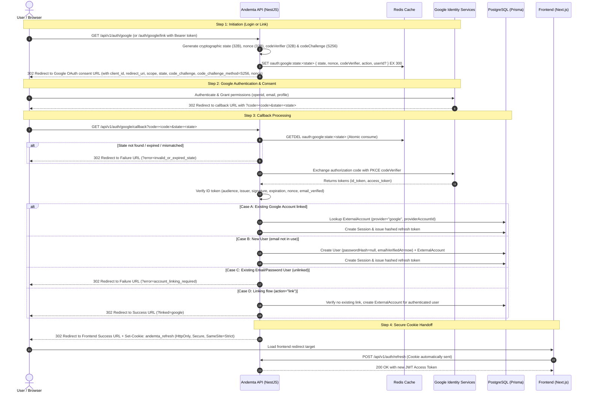

# Andemta Architecture — Google OAuth 2.0 Authentication (Phase 3.8)

## 1. Overview & Architecture

Google OAuth 2.0 authentication allows users to sign in or register with their verified Google accounts using the OAuth 2.0 Authorization Code Flow enhanced with **PKCE (Proof Key for Code Exchange with S256)** and **OIDC Nonce** validation.

The implementation is backend-driven, standards-compliant, and strictly maintains account security boundaries without allowing automated account hijacking.

### Key Endpoints

| Method | Endpoint | Protection | Description |
|---|---|---|---|
| `GET` | `/api/v1/auth/google` | Public | Initiates Google OAuth login flow. Redirects user to Google OAuth consent screen. |
| `GET` | `/api/v1/auth/google/link` | Authenticated (`JwtAuthGuard`) | Initiates explicit Google identity linking for current user. |
| `GET` | `/api/v1/auth/google/callback` | Public | Receives Google redirect with `code` & `state`, exchanges code, creates session or links account, sets HttpOnly refresh cookie, and redirects to frontend. |

---

## 2. Sequence Diagram (Authorization Code Flow with PKCE & Nonce)



---

## 3. Account Resolution Scenarios

| Scenario | State in Database | Action Taken |
|---|---|---|
| **Case A: Existing Google Account** | `ExternalAccount` exists matching `provider = 'google'` and `providerAccountId`. | Issues new session, attaches HttpOnly refresh cookie, and redirects to frontend success URL. |
| **Case B: New User Registration** | Google ID and email not found in database. | Creates new `User` record with `passwordHash: null`, `emailVerifiedAt: new Date()`, creates associated `ExternalAccount` record, establishes session, attaches HttpOnly cookie, and redirects to frontend success URL. |
| **Case C: Unlinked Existing Email** | User exists with same email, but no `ExternalAccount` linked to this Google account. | **Rejects automatic linking** to prevent account takeover. Redirects to frontend failure URL with `?error=account_linking_required`. User must sign in with password first and perform authenticated linking. |
| **Case D: Authenticated Linking** | User initiates `/api/v1/auth/google/link` while authenticated. Google account is not claimed. | Creates `ExternalAccount` linked to authenticated `userId`. Redirects to frontend success URL with `?linked=google`. |
| **Case E: Linking Conflict** | Google account is already linked to another user, or user already has Google linked. | Rejects with `?error=external_account_conflict` or `?error=user_already_linked`. |

---

## 4. Security & Cryptographic Safeguards

1. **PKCE (Proof Key for Code Exchange) with S256**:
   - High-entropy code verifier generated via `crypto.randomBytes(32).toString('base64url')` (256 bits).
   - Code challenge derived via SHA-256 (`crypto.createHash('sha256').update(verifier).digest('base64url')`).
   - Prevents authorization code injection and interception attacks.

2. **Single-Use State with Atomic Invalidation**:
   - OAuth `state` is a 256-bit cryptographic token.
   - Stored in Redis under `oauth:google:state:<state>` with a 300-second (5-minute) TTL.
   - Consumed using Redis atomic `GETDEL` (`redis.getdel(key)`). Any replay attempt immediately fails with `invalid_or_expired_state`.

3. **OIDC Nonce Verification**:
   - Random 256-bit nonce bound to the session state and validated against the Google ID token claims (`payload.nonce === storedTransaction.nonce`).
   - Protects against ID token replay attacks.

4. **Cryptographic ID Token Verification**:
   - Uses official `google-auth-library` (`OAuth2Client.verifyIdToken()`).
   - Validates Google RS256 signature against Google's public JWKS certificates.
   - Validates `iss` (`https://accounts.google.com` or `accounts.google.com`).
   - Validates `aud` matches `GOOGLE_CLIENT_ID`.
   - Validates token is not expired (`exp`).
   - Validates `email_verified === true` (unverified Google accounts are rejected with `email_not_verified`).

5. **Anti-Account Takeover Defense**:
   - An attacker cannot register an arbitrary Google account with a victim's email address and hijack an existing Andemta password-based account.
   - Accounts can only be linked via the explicitly authenticated `/api/v1/auth/google/link` endpoint.

6. **Token Leakage Prevention**:
   - Zero raw tokens, authorization codes, or user credentials in URL query parameters.
   - Session handoff strictly leverages the existing HttpOnly, Secure, SameSite refresh cookie (`andemta_refresh`).
   - Frontend exchanges the refresh cookie for a short-lived JWT access token via `POST /api/v1/auth/refresh`.

---

## 5. Google Cloud Console Configuration Guide

1. Navigate to [Google Cloud Console](https://console.cloud.google.com/).
2. Create or select your Google Cloud project (e.g., `andemta-production`).
3. Navigate to **APIs & Services** > **OAuth consent screen**:
   - User Type: **External**
   - App Name: `Andemta`
   - User Support Email: Support/Admin email
   - Developer Contact Email: Technical contact email
   - Scopes: `openid`, `.../auth/userinfo.email`, `.../auth/userinfo.profile`
4. Navigate to **APIs & Services** > **Credentials**:
   - Click **Create Credentials** > **OAuth client ID**.
   - Application Type: **Web application**.
   - Name: `Andemta Web Backend`.
   - **Authorized JavaScript origins**:
     - `http://localhost:3000` (Local Frontend)
     - `https://andemta.et` (Production Frontend)
   - **Authorized redirect URIs**:
     - `http://localhost:4000/api/v1/auth/google/callback` (Local Backend)
     - `https://api.andemta.et/api/v1/auth/google/callback` (Production Backend)
5. Copy the **Client ID** and **Client Secret** into your `.env` configuration.

---

## 6. Environment Configuration

```env
# Google OAuth Configuration
GOOGLE_CLIENT_ID=your-google-client-id.apps.googleusercontent.com
GOOGLE_CLIENT_SECRET=GOCSPX-your-google-client-secret
GOOGLE_CALLBACK_URL=http://localhost:4000/api/v1/auth/google/callback
FRONTEND_GOOGLE_AUTH_SUCCESS_URL=http://localhost:3000/auth/google/callback
FRONTEND_GOOGLE_AUTH_FAILURE_URL=http://localhost:3000/login
GOOGLE_OAUTH_STATE_TTL_SECONDS=300
```

---

## 7. Verification & Testing

### Running Unit Tests
```powershell
npm run test --workspace=@andemta/api -- google-oauth.service auth.controller
```

### Running E2E Integration Tests
```powershell
npm run test:e2e --workspace=@andemta/api -- auth-google.e2e-spec.ts
```

### Testing All Auth E2E Suites
```powershell
npm run test:e2e --workspace=@andemta/api -- auth-google auth-password-recovery auth-login auth-session auth-email-verification
```
