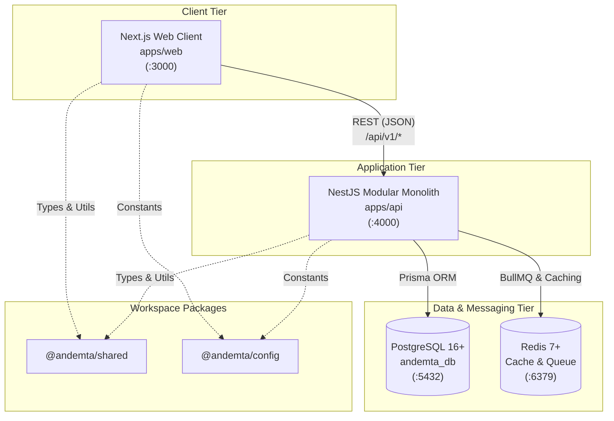

# Andemta Architectural Overview

This document describes the high-level architecture, design decisions, and system boundaries for **Andemta**, an Ethiopian Consumer Research Marketplace.

---

## 1. Architectural Strategy

Andemta is structured as a **Monorepo** hosting a **Modular Monolith** backend alongside a modern **Next.js** web application and shared utility libraries.

---

## 2. Why a Monorepo?

1. **Unified Codebase & Single Source of Truth:**
   All application code, domain contracts, shared DTOs, and configuration standards live in one repository. This eliminates synchronization lag and package version drifting between frontend and backend teams.

2. **Atomic Changes & Type Sharing:**
   Changes to contracts, enum values, and validation types in `@andemta/shared` can be applied and verified across both `@andemta/api` and `@andemta/web` simultaneously.

3. **Simplified Developer Experience:**
   A single `npm install` bootstraps the entire developer workspace. A single root command (`npm run dev`) launches both services with concurrent logging.

4. **Zero-Overhead Tooling:**
   By leveraging native **npm workspaces**, we avoid premature dependencies on complex build orchestrators while retaining the clean boundaries of a monorepo.

---

## 3. Why a Modular Monolith?

Rather than fragmenting into distributed microservices prematurely, Andemta utilizes a **Modular Monolith** pattern inside NestJS:

- **High Cohesion, Low Coupling:** Domain capabilities (Users, Organizations, Surveys, Products, Rewards) are isolated into self-contained NestJS modules with explicit exported interfaces.
- **Simpler Operations & Observability:** A single deployment artifact simplifies debugging, transaction management, logging, and infrastructure maintenance during the startup and scaling phases.
- **Future-Proof Extensibility:** Well-bounded modules with strict boundaries can easily be extracted into independent microservices in the future should traffic patterns or organizational requirements demand it.

---

## 4. Component Responsibilities

### 4.1 Frontend (`apps/web`)
- **Technology:** Next.js (App Router), TypeScript, Tailwind CSS, shadcn/ui.
- **Responsibilities:**
  - Client-side rendering, server components, and responsive UI for both Research Organizations and Research Participants.
  - Interactive survey taking and product-testing walkthroughs.
  - Role-based dashboard interfaces for commissioning studies and reviewing analytics.
  - Client-side token management (holding short-lived JWT access tokens in memory).

### 4.2 Backend (`apps/api`)
- **Technology:** NestJS, TypeScript, Express, Prisma ORM, BullMQ.
- **Responsibilities:**
  - RESTful API endpoints rooted at `/api/v1`.
  - Authentication & Authorization: JWT validation, Argon2 password hashing, RBAC, Google OAuth.
  - Research marketplace business logic, data validation, and transactional integrity.
  - Automated scheduling and queue processing (participant notifications, reward disbursement, digest generation).

### 4.3 Shared Packages (`packages/*`)
- **`@andemta/shared`:** Platform-wide interfaces, API response structures, shared constants, validation schemas, and common TypeScript types.
- **`@andemta/config`:** Default connection ports, routing prefixes, and environment keys common across applications.

---

## 5. Local Infrastructure: PostgreSQL & Redis

### 5.1 PostgreSQL (`andemta_db`)
- **Role:** Primary relational data store.
- **Execution:** Installed directly on the Windows host machine, listening on port `5432`.
- **Access:** Accessed by the NestJS backend via Prisma ORM using standard connection strings:
  `postgresql://<user>:<password>@localhost:5432/andemta_db?schema=public`
- **Data Responsibility:** Storing user accounts, organization profiles, survey questions, consumer responses, audit logs, and transaction ledgers.

### 5.2 Redis
- **Role:** In-memory caching, rate limiting, and BullMQ background job broker.
- **Execution:** Runs inside WSL2 Ubuntu, bridged to Windows host via `localhost:6379`.
- **Access:** Direct TCP connection from NestJS backend.
- **Data Responsibility:**
  - Session and refresh token tracking/revocation.
  - Asynchronous background tasks (email dispatch, report compilation, participant matching queues).
  - High-traffic response caching.

---

## 6. Frontend & Backend Communication

1. **Protocol:** Standard RESTful HTTP/HTTPS using JSON payloads.
2. **API Pathing:** All API endpoints are prefixed with `/api/v1/` (e.g., `http://localhost:4000/api/v1/health`).
3. **CORS:** The NestJS backend is configured with Cross-Origin Resource Sharing (CORS) permitting requests from `http://localhost:3000` with credentials enabled.
4. **Environment Configuration:**
   - Frontend accesses the backend URL through `NEXT_PUBLIC_API_URL` (e.g. `http://localhost:4000/api/v1`).
   - Backend accesses the frontend URL through `FRONTEND_URL` (e.g. `http://localhost:3000`).

