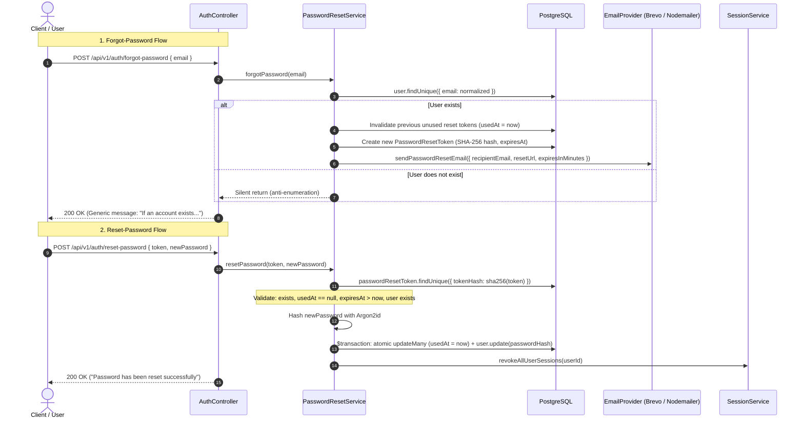

# Andemta Architecture — Password Recovery (Phase 3.7)

## 1. Overview & Architecture

The Password Recovery system allows users who have lost access to their accounts to safely reset their credentials without exposing account status, credentials, or persistence tokens to third parties or attackers.

The workflow consists of two primary endpoints:
1. `POST /api/v1/auth/forgot-password` — Requests a password reset link.
2. `POST /api/v1/auth/reset-password` — Validates the token and updates the user's password.



---

## 2. Token Security & Cryptographic Lifecycle

### Cryptographic Entropy
- **Raw Token Generation**: 32 cryptographically secure random bytes generated using Node.js `crypto.randomBytes(32)` and encoded as Base64URL. This provides 256 bits of entropy, rendering brute-force enumeration impossible.
- **Persistence Security**: Raw tokens are **never persisted** in the database. Only their SHA-256 hex digest (`crypto.createHash('sha256').update(rawToken).digest('hex')`) is stored in the `password_reset_tokens` table.
- **Confidentiality**: Raw tokens and token hashes are never logged, never returned in API response bodies, and never included in error responses.

### Expiry and Single-Use
- **Configurable TTL**: Defaults to 30 minutes (`PASSWORD_RESET_TOKEN_TTL_MINUTES`), configurable via environment variables.
- **Immediate Invalidation of Prior Tokens**: When a new reset request is processed for a user, all prior unused reset tokens for that user are marked as used (`usedAt = new Date()`), ensuring that at any moment only the latest link can be active.
- **Atomic Single-Use**: Token consumption uses conditional database updates:
  ```typescript
  const consumeResult = await tx.passwordResetToken.updateMany({
    where: { id: tokenRecord.id, usedAt: null },
    data: { usedAt: new Date() },
  });
  if (consumeResult.count === 0) {
    throw new BadRequestException('Invalid or expired password reset token');
  }
  ```
  If two concurrent requests attempt to consume the same token simultaneously, exactly one succeeds and the other receives a `400 Bad Request`.

---

## 3. Account Enumeration & Information Leak Prevention

1. **Uniform Public Responses**: Both existing and non-existent email addresses receive the exact same HTTP 200 response:
   ```json
   {
     "success": true,
     "message": "If an account exists for this email address, password reset instructions will be sent.",
     "data": {},
     "meta": null
   }
   ```
2. **Email Delivery Failure Handling**: If the SMTP provider fails to deliver the email, the newly issued token is invalidated in the database, a sanitized operational error is logged internally, and the endpoint still returns the uniform generic response to the caller without exposing credentials or delivery errors.
3. **Consistent Error Codes**: Reset requests with expired, already-consumed, invalid, or nonexistent tokens return an identical `400 Bad Request` with the message `'Invalid or expired password reset token'`.

---

## 4. Password Policy & Hashing

- **Length Constraints**: Minimum 12 characters, maximum 128 characters.
- **Character Policy**: No restrictive character set requirements. Unicode characters, symbols, and whitespace are fully supported and preserved without trimming or alteration.
- **Argon2id Hashing**: Sourced from `PasswordHashingService` using OWASP-recommended parameters:
  - Memory cost: 19456 KiB (~19 MiB)
  - Time cost: 2 iterations
  - Parallelism: 1 thread
  - Type: Argon2id (hybrid defense against side-channel and GPU attacks)

---

## 5. Session Revocation & Access Token Limitations

### Session Revocation
Immediately following a successful password update:
- `sessionService.revokeAllUserSessions(userId)` is executed.
- All persistent session records in PostgreSQL for that user are marked with `revokedAt = new Date()`.
- Existing session rows are **preserved** for audit and security analysis purposes (never deleted).
- Any subsequent attempt to use a revoked refresh token to rotate or refresh a session fails with `401 Unauthorized` (`Session has been revoked`).
- Other users' active sessions are completely unaffected.

### Access Token Limitations
- Andemta uses stateless signed JWT access tokens (`HS256`) with a short default lifetime of 15 minutes (`JWT_ACCESS_EXPIRES_IN=15m`).
- In accordance with stateless JWT architecture, access tokens that were issued *prior* to the password reset remain cryptographically valid until their short expiry timestamp (at most 15 minutes).
- No distributed blacklist is introduced in this phase, preserving low database read latency and system simplicity.

---

## 6. Rate Limiting & Abuse Prevention

### Current Status
Rate-limiting infrastructure (such as `@nestjs/throttler` or Redis-backed sliding window limiters) is **not currently configured** in `app.module.ts`.

### Security Implications & Mitigation
- `POST /api/v1/auth/forgot-password` and `POST /api/v1/auth/reset-password` are public endpoints vulnerable to request flooding and SMTP quota exhaustion.
- **Recommended Follow-up**: Introduce a Redis-backed rate limiter on `POST /api/v1/auth/forgot-password` (e.g., maximum 5 requests per IP per 15 minutes, and maximum 3 reset requests per email per hour) using a dedicated guard.

---

## 7. Environment Variables

| Variable | Type | Default | Description |
|---|---|---|---|
| `PASSWORD_RESET_TOKEN_TTL_MINUTES` | integer | `30` | Lifetime in minutes for password reset tokens |
| `FRONTEND_PASSWORD_RESET_URL` | URI string | `http://localhost:3000/reset-password` | Base URL for frontend password reset page |
| `EMAIL_HOST` | string | `smtp-relay.brevo.com` | SMTP relay hostname |
| `EMAIL_PORT` | number | `587` | SMTP port |
| `EMAIL_USER` | string | `''` | SMTP authentication username |
| `EMAIL_PASSWORD` | string | `''` | SMTP authentication password |
| `EMAIL_FROM` | string | `Andemta <no-reply@andemta.et>` | Sender address |

---

## 8. API Specification & Examples

### 1. Request Password Reset
- **URL**: `POST /api/v1/auth/forgot-password`
- **Headers**: `Content-Type: application/json`
- **Request Body**:
  ```json
  {
    "email": "researcher@andemta.et"
  }
  ```
- **Response** (HTTP 200 OK):
  ```json
  {
    "success": true,
    "message": "If an account exists for this email address, password reset instructions will be sent.",
    "data": {},
    "meta": null
  }
  ```

### 2. Reset Password
- **URL**: `POST /api/v1/auth/reset-password`
- **Headers**: `Content-Type: application/json`
- **Request Body**:
  ```json
  {
    "token": "E1dY9_X1Qo0Q1s_wYx7u3A9-V1b-sample-raw-token",
    "newPassword": "NewSecurePassword2026!"
  }
  ```
- **Response** (HTTP 200 OK):
  ```json
  {
    "success": true,
    "message": "Password has been reset successfully",
    "data": {},
    "meta": null
  }
  ```
- **Error Response** (HTTP 400 Bad Request):
  ```json
  {
    "success": false,
    "message": "Invalid or expired password reset token",
    "data": null,
    "errors": []
  }
  ```

---

## 9. Verification & Testing

### Running Tests
```powershell
# Run password recovery unit tests
npm run test --workspace=@andemta/api -- password-reset token.utils forgot-password reset-password

# Run password recovery E2E tests
npm run test:e2e --workspace=@andemta/api -- auth-password-recovery.e2e-spec.ts

# Run all authentication E2E regression tests
npm run test:e2e --workspace=@andemta/api
```
