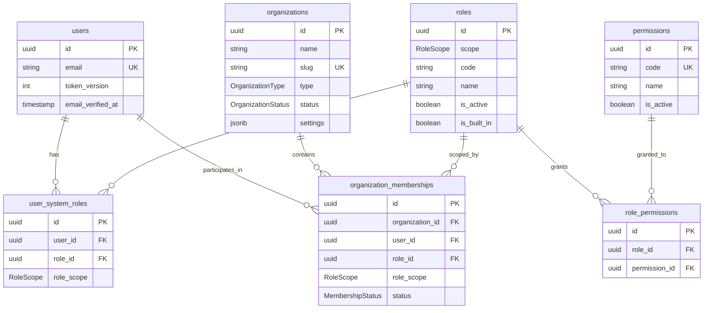

# RBAC Database Foundation Architecture

**Document Version:** 1.0.0  
**Phase:** 4.1 — RBAC Database Foundation  
**Target:** Andemta Ethiopian Consumer Research Marketplace  
**Status:** Approved & Implemented  

---

## 1. Overview & Authorization Architecture

The Andemta platform implements a **Dual-Scope Role-Based Access Control (RBAC)** architecture that strictly segregates global platform responsibilities from tenant-level organizational authorizations:

1. **System-Level Roles (`RoleScope.SYSTEM`)**:
   - Apply platform-wide across all platform entities and global features.
   - Initial built-in roles: `PARTICIPANT`, `ADMIN`.
   - A user may possess multiple system-level roles (e.g. a user may be both a `PARTICIPANT` in general research and an `ADMIN` on the platform, or have custom system roles in future phases).
2. **Organization-Level Roles (`RoleScope.ORGANIZATION`)**:
   - Apply strictly within the boundary of a specific `Organization` (Business, University, or other research entity).
   - Initial built-in roles: `OWNER`, `ADMIN`, `RESEARCHER`, `VIEWER`.
   - A user can belong to multiple organizations and hold completely different roles in each (e.g. `RESEARCHER` at Addis Ababa University, and `VIEWER` at a partner corporation).
   - An organization `OWNER` never automatically receives platform `ADMIN` privileges.

---

## 2. Entity-Relationship Model



---

## 3. Database Model Responsibilities & Schema

### 3.1 `Role` Model (`roles` table)
- **Scope**: Identified by `RoleScope` enum (`SYSTEM` vs `ORGANIZATION`).
- **Composite Unique Identifiers**:
  - `@@unique([scope, code])`: Guarantees role codes are unique within their scope. Allows `ADMIN` to exist distinctly under `SYSTEM` (Platform Administrator) and `ORGANIZATION` (Organization Administrator).
  - `@@unique([id, scope])`: Enables composite foreign key constraints enforcing scope boundaries at the database engine level.
- **Attributes**: `is_active` (for disabling roles), `is_built_in` (distinguishing system-seeded roles from future custom roles).

### 3.2 `Permission` Model (`permissions` table)
- **Code**: Unique string code following resource-action naming (e.g. `research.create`, `survey.respond`).
- **Attributes**: Human-readable `name`, optional `description`, and `is_active` flag.

### 3.3 `RolePermission` Model (`role_permissions` table)
- **Many-to-Many Join Table**: Links `Role` and `Permission`.
- **Constraint**: `@@unique([roleId, permissionId])` prevents duplicate assignments.
- **Cascade**: Deleting a role or permission cleanly cascades to this table.

### 3.4 `UserSystemRole` Model (`user_system_roles` table)
- **Purpose**: Connects users to system-scoped roles.
- **Scope Purity Enforcement**:
  - Contains `role_scope` defaulting to `'SYSTEM'`.
  - Database check constraint: `CHECK ("role_scope" = 'SYSTEM')`.
  - Foreign key: `FOREIGN KEY ("role_id", "role_scope") REFERENCES "roles"("id", "scope")`.
  - **Result**: PostgreSQL physically rejects any attempt to insert an organization-scoped role into `user_system_roles`.
- **Duplicate Prevention**: `@@unique([userId, roleId])`.

### 3.5 `Organization` Model (`organizations` table)
- **Attributes**: `name`, unique `slug` (URL-safe identifier), `type` (`BUSINESS`, `UNIVERSITY`, `OTHER`), `status` (`ACTIVE`, `SUSPENDED`, `INACTIVE`), and `settings` (`JsonB` for future extensibility).

### 3.6 `OrganizationMembership` Model (`organization_memberships` table)
- **Purpose**: Connects a user to an organization with a specific organization role.
- **Scope Purity Enforcement**:
  - Contains `role_scope` defaulting to `'ORGANIZATION'`.
  - Database check constraint: `CHECK ("role_scope" = 'ORGANIZATION')`.
  - Foreign key: `FOREIGN KEY ("role_id", "role_scope") REFERENCES "roles"("id", "scope")`.
  - **Result**: PostgreSQL physically rejects any attempt to insert a system-scoped role into `organization_memberships`.
- **Duplicate Prevention**: `@@unique([userId, organizationId])` guarantees a user holds at most one role assignment per organization.
- **Workflow Support**: `status` field (`ACTIVE`, `INVITED`, `SUSPENDED`, `INACTIVE`) accommodates future invite/suspension states without implementing those workflows now.

---

## 4. Built-in Roles Catalog

### 4.1 System Roles (`RoleScope.SYSTEM`)
1. **`PARTICIPANT`**:
   - General consumer research participant.
   - Authorizations: Answering surveys, engaging in product testing, and claiming earned reward incentives.
2. **`ADMIN`**:
   - Platform super-administrator.
   - Authorizations: Full platform configuration, user account moderation, audit log inspection, and global operational metrics.

### 4.2 Organization Roles (`RoleScope.ORGANIZATION`)
1. **`OWNER`**:
   - Organization primary account holder and billing authority.
   - Full control over organization settings, billing, deletion, membership roster, research projects, surveys, and reward payouts.
2. **`ADMIN`**:
   - Delegated organization manager.
   - Full control over research projects, surveys, rosters, and operational settings, with the exception of organization deletion.
3. **`RESEARCHER`**:
   - Active research practitioner.
   - Authorizations: Create, edit, publish research studies and surveys, recruit participants, conduct product tests, and export research reports.
4. **`VIEWER`**:
   - Read-only observer.
   - Authorizations: Inspect organization profile, projects, survey designs, and aggregated insight summaries.

---

## 5. Permission Catalog & Role-Permission Matrix

A catalog of **36 granular permissions** is defined across 10 functional domains, mapped to roles under the **Principle of Least Privilege**:

| Permission Code | Domain | PARTICIPANT | SYS:ADMIN | ORG:OWNER | ORG:ADMIN | ORG:RESEARCHER | ORG:VIEWER |
| :--- | :--- | :---: | :---: | :---: | :---: | :---: | :---: |
| `users.read` | Users | | ✓ | | | | |
| `users.manage` | Users | | ✓ | | | | |
| `platform.admin` | Platform | | ✓ | | | | |
| `platform.audit.read` | Platform | | ✓ | | | | |
| `platform.metrics.read` | Platform | | ✓ | | | | |
| `organization.read` | Organization | | ✓ | ✓ | ✓ | ✓ | ✓ |
| `organization.update` | Organization | | | ✓ | ✓ | | |
| `organization.delete` | Organization | | | ✓ | | | |
| `organization.billing.manage` | Organization | | | ✓ | ✓ | | |
| `organization.members.read` | Members | | | ✓ | ✓ | ✓ | ✓ |
| `organization.members.invite` | Members | | | ✓ | ✓ | | |
| `organization.members.update` | Members | | | ✓ | ✓ | | |
| `organization.members.remove` | Members | | | ✓ | ✓ | | |
| `research.create` | Research | | | ✓ | ✓ | ✓ | |
| `research.read` | Research | | ✓ | ✓ | ✓ | ✓ | ✓ |
| `research.update` | Research | | | ✓ | ✓ | ✓ | |
| `research.delete` | Research | | | ✓ | ✓ | | |
| `research.publish` | Research | | | ✓ | ✓ | ✓ | |
| `survey.create` | Survey | | | ✓ | ✓ | ✓ | |
| `survey.read` | Survey | | ✓ | ✓ | ✓ | ✓ | ✓ |
| `survey.update` | Survey | | | ✓ | ✓ | ✓ | |
| `survey.delete` | Survey | | | ✓ | ✓ | | |
| `survey.publish` | Survey | | | ✓ | ✓ | ✓ | |
| `survey.respond` | Survey | ✓ | | | | | |
| `participants.read` | Participants | | | ✓ | ✓ | ✓ | |
| `participants.recruit` | Participants | | | ✓ | ✓ | ✓ | |
| `product_testing.create` | Product Testing | | | ✓ | ✓ | ✓ | |
| `product_testing.read` | Product Testing | | | ✓ | ✓ | ✓ | ✓ |
| `product_testing.update` | Product Testing | | | ✓ | ✓ | ✓ | |
| `product_testing.delete` | Product Testing | | | ✓ | ✓ | | |
| `product_testing.participate` | Product Testing | ✓ | | | | | |
| `reports.read` | Reports | | ✓ | ✓ | ✓ | ✓ | ✓ |
| `reports.export` | Reports | | | ✓ | ✓ | ✓ | |
| `rewards.distribute` | Rewards | | | ✓ | ✓ | | |
| `rewards.read` | Rewards | | ✓ | ✓ | ✓ | | |
| `rewards.claim` | Rewards | ✓ | | | | | |

---

## 6. Migration and Seed Instructions

### 6.1 Executing the Migration
The non-destructive migration has been created and applied under:
`apps/api/prisma/migrations/20261123091508_add_rbac_database_foundation/migration.sql`

To apply in any environment:
```bash
npm run prisma:migrate:deploy --workspace=@andemta/api
```

### 6.2 Executing the Seed
To idempotently populate the built-in roles, permissions, role-permission links, and safely backfill existing users:
```bash
npm run prisma:seed --workspace=@andemta/api
```
- Running the seed repeatedly is completely idempotent (uses `upsert` across all composite keys).
- It never overwrites custom roles or destructively modifies existing data.

---

## 7. Existing User Backfill Strategy

To ensure non-destructive compatibility with users registered during Phase 3:
1. `backfillParticipantRoleForExistingUsers()` queries all `User` records having zero associations in `UserSystemRole`.
2. For each unassigned user, it explicitly inserts a record assigning `PARTICIPANT` (`RoleScope.SYSTEM`).
3. **Security Safeguards**:
   - It **never** assigns `ADMIN` or elevated privileges.
   - It **never** creates organization memberships or assigns organization roles.
   - Running the backfill multiple times is a no-op once users are backfilled.

---

## 8. Decisions Deferred to Later Phases

In strict accordance with Phase 4.1 boundaries, the following were intentionally deferred:
- **Phase 4.2+**: Runtime NestJS authorization guards (`RolesGuard`, `PermissionsGuard`), decorators (`@RequirePermissions()`, `@RequireRoles()`), and interceptors.
- **Phase 4.3+**: Role-management and organization-management HTTP APIs.
- **Phase 4.4+**: Membership invitation, acceptance, and revocation workflows.
- **Phase 4.5+**: JWT claim updates (role/permission claims in access tokens).
- **Phase 4.6+**: Frontend role handling, route protection, and dashboard navigation.
